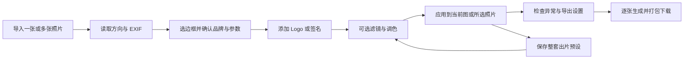

# 拾光 Frame & Tone｜图片处理 Web 产品方案

版本：概念方案 v0.1 · 2026-11-09（北京时间）。名称为暂定工作名，未做商标或域名核验。

## 1. 产品结论（已按“边框水印 App”方向调整）

根据用户补充「边框水印 APP 那种功能」，建议定位为「摄影边框水印的 Web 出片工具」：以边框模板为入口，自动读取相机品牌和 EXIF，添加个人 Logo／签名，可选滤镜，最后批量导出。整套边框、参数显示规则、标识及调色可存成个人预设。

主要对标「边框水印APP」「边框水印-光影边框大师」「一行水印」「印记」及 Web 工具 Mark；Canva、Lightroom 等仅作辅助参考。批量和个人预设在同类 App 中已经存在，属于基本能力。Web 端的机会是免安装、桌面大图精调、本地处理和多图批量下载；这些属于待验证的产品价值，不宣称行业首创。

首版优先服务摄影爱好者、旅行记录者、摄影内容创作者。核心价值是在桌面浏览器中快速完成摄影作品装裱、参数标注与个人署名，辅助轻调色。

这是一项基于竞品能力和本次需求提出的产品假设，尚未经过用户访谈、使用数据或付费意愿验证。竞品资料见同目录《竞品调研.md》；不将搜索结果当作市场份额排名。

## 2. 需求解释与范围

本方案把「照片参数」理解为两层：

- **展示参数**：相机、镜头、焦距、光圈、快门、ISO、拍摄时间，以及可选标题。读取 EXIF 后排版到照片内或边框上，可人工修正。
- **调整参数**：曝光、对比度、高光、阴影、色温、饱和度，以及滤镜强度。

首版的「添加参数」指添加可见文字，不修改原文件，也不提供通用 EXIF 写入编辑器。人工修正的值在编辑器中标注「手动」，不会伪装为相机原始记录。地点默认不显示，签名默认使用用户自有素材或文字。

暂不做 RAW 显影、复杂图层、局部蒙版、人像美颜、生成式 AI、社区、交易市场和团队协作。

## 3. 用户与关键任务

| 用户 | 当前任务 | 首版应解决的问题 |
| --- | --- | --- |
| 摄影爱好者 | 分享带拍摄参数的作品 | 自动提取，避免逐字段输入；缺失字段可补填 |
| 内容创作者 | 让一组照片有一致风格 | 一套滤镜、边框、签名复用到多张照片 |
| 独立摄影师 | 为作品添加个人标识 | 透明 Logo／签名、相对定位、原尺寸导出 |

优先验证三个问题：用户是否愿意在浏览器调色；是否更看重参数边框而非图片内水印；批量出片的频率是否足够支撑订阅。建议先访谈 8–12 名目标用户，并让其用原有工具和本产品分别完成同一组任务。

## 4. 核心流程



默认入口为边框模板库；选择模板后导入照片，或先导入后选择模板。首次默认「经典参数栏」和原图色彩。无需登录即可导入和导出。导航各步骤可自由切换；流程图表示推荐顺序，不强制线性操作。

首次体验目标：一张有完整 EXIF 的照片，用户只需导入、选预设、导出即可得到作品；复杂设置按需展开。

## 5. 信息架构与界面

工作台采用桌面优先的四区布局：最左为排版／滤镜／标识／导出导航，左侧展示模板或素材，中间为预览和照片队列，右侧展示当前工具的参数。顶部提供导入、保存预设、撤销／重做和导出。

| SVG 页面 | 主要操作 | 关键状态 |
| --- | --- | --- |
| 00 边框模板库 | 浏览经典参数、留白、虚化、电影胶片、拍立得与透明内嵌 | 分类、收藏、我的预设、使用模板 |
| 01 参数排版 | 选择模板、修正 EXIF、显示／隐藏字段、调整边距和底栏 | 自动读取成功、缺失、手动覆盖 |
| 02 滤镜调色 | 选择预设、调整强度、基础调色、同步调色 | 原图、已修改、按住查看原图 |
| 03 标识签名 | 素材导入、文字标识、位置、大小、透明度、阴影 | 照片内／底栏、透明素材、缺失素材 |
| 04 批量导出 | 检查照片、缺失字段处理、格式、尺寸、隐私、打包 | 待生成、生成中、成功、失败、取消 |

原型画布为 1600 × 1040，适合桌面端评审。SVG 为静态、可编辑矢量文件；左侧导航具备页面间链接，滑块、上传及导出按钮不执行真实处理。山景为原创矢量示意，虚化背景使用概念底色与层次示意，不用于证明真实滤镜或模糊效果。

小屏适配作为后续设计：低于 1100px 时将两侧设置合并为单侧抽屉；手机采用底部工具栏和设置面板。本次交付未包含独立移动端原型。

## 6. 首版功能定义

### 6.1 导入与照片队列（P0）

- 支持本地 JPG、PNG、WebP；拖拽和文件选择；单张与多张共用流程。
- 读取拍摄方向并正规化画面；按需生成小预览，避免同时解码所有原图。
- 显示文件名、方向、尺寸、EXIF 完整度、选中状态；支持移除单张、清空队列和新增。
- 不支持的 HEIC／RAW 等格式在导入时明确提示转换要求，不等到导出时失败；HEIC 解码放入后续评估。
- 初始产品限制建议为每批 50 张、单文件 50 MB、单图 32 MP，同时约束尺寸上限；这些是待压测调整的设计值，不是已验证能力。为解码过大、损坏文件和内存不足提供具体提示。

### 6.2 参数与边框（P0）

- 字段：相机型号、镜头、焦距、光圈、快门、ISO；可选拍摄日期、作品标题和版权文字。地点需用户主动开启。
- 字段分别保存原始值、展示值和来源（EXIF／手动），支持恢复自动读取值。
- 没有 EXIF 时不阻止编辑：提示补填，或自动隐藏缺失字段；不显示「undefined」「0mm」和空分隔符。
- 首批提供 6 类模板：经典参数栏、极简留白、虚化背景、电影胶片、拍立得手记、透明内嵌。参数设置沿用同一套字段规则。
- 品牌标识与个人签名独立：依据 EXIF Make 匹配相机品牌，可手动切换、隐藏或上传自定义 PNG 图标；无匹配时回退品牌文字。首批品牌覆盖按目标用户器材分布确定。
- 虚化背景从原图生成填充背景，照片主体保持完整；支持背景模糊强度、明暗、图片圆角、阴影、边距与间距。电影／拍立得提供装饰框，裁切需用户明确选择。
- 自适应横图和竖图，完整保留照片；边框作为外扩区域添加。调整外边距、底栏高度、底色、字号和对齐。
- 相机品牌库和个人标识库分开管理；品牌匹配规则可配置。未配置图标时使用文字回退，用户可以导入所需品牌图标并保存映射。

### 6.3 滤镜与基础调色（P0）

- 首批 8 款自有滤镜，覆盖自然、暖色、青绿、复古和黑白风格；数量以质量验收为准。
- 支持滤镜强度 0–100%，曝光、对比度、高光、阴影、色温和饱和度；有重置、撤销和原图对比。
- 滤镜只作用于照片区域，签名、Logo、边框和文字随后合成。
- 先实现自有可控参数预设；第三方 LUT 和 XMP 导入放入 P1，不能直接假设兼容 Lightroom 预设。
- 编辑不覆盖原图，只保存参数；所有预览与导出使用同一套滤镜定义和运算顺序。

### 6.4 Logo／签名（P0）

- 导入透明 PNG，或创建文字签名；WebP 透明素材可随图片解码能力支持。首版不直接执行用户上传 SVG。
- 支持照片内或底栏两种位置；九宫格定位、相对宽度、安全边距、不透明度、颜色覆盖和轻微阴影。
- 普通 Logo 默认保持原色；单色签名可选择白／黑色。签名素材和文字素材区分处理，避免将彩色 Logo 意外染色。
- 多个标识可在本地素材库中管理；每张首版最多启用一个主标识，版权文字单独控制。
- P1 再增加手写画板、白底签名抠图和自由拖拽。用户上传签名文件即可完成首版核心流程。

### 6.5 两类预设（P0）

- **调色预设**：只包含滤镜及调色参数。
- **出片预设**：包含调色、模板、字段显示规则、标识引用和导出默认值。
- 出片预设保存的是「每张读取自己的光圈／快门」规则，绝不把样片的 ISO 等具体值固定套到全部照片。作品标题、相机手动覆盖默认不进入共享预设。
- 支持新建、命名、复制、更新和删除。更新需明确动作；切换前保留当前未保存编辑，以便撤销。
- 首版本地持久化；跨设备同步、预设分享和公开预设库为 P1/P2。

### 6.6 批量应用与导出（P0）

- 各模块支持「同步到所选照片」；原型用三张全选场景展示「同步到全部照片」。同步前显示数量与作用范围，单张覆盖保留到用户主动同步时。
- JPG / PNG / WebP；JPG 默认质量 92，允许调整。PNG 不显示无效的有损质量设置。
- 尺寸可选原尺寸或长边像素值，明确尺寸包含边框；默认不放大照片。
- 单张直接下载，批量 ZIP。命名为原文件名 + `_shiguang`，同名追加序号。
- 默认不写入源 EXIF，移除 GPS；画面上的参数文字与文件元数据是两套独立设置。
- 用户主动选择保留 EXIF 时，提示可能包含位置数据；重新编码后尺寸和方向等结构字段必须重建，不能原样复制 Orientation。可复制字段与写入库需在开发技术验证中明确。
- 显示完成张数／总数、当前文件和失败原因；可取消，已成功项可下载；失败项可单独重试，避免整批重跑。
- 首版使用逐张渲染、受限并发，主动释放位图与 Object URL；大 ZIP 打包使用流式方案或按大小分包。

## 7. 交互规则与边界

| 情况 | 处理规则 |
| --- | --- |
| EXIF 完整／部分缺失 | 自动填入有值字段；缺失项提示，不猜测拍摄值 |
| 手动改了参数文字 | 显示「手动」标记；支持恢复，不改原文件 |
| 竖图／横图混合 | 相对布局与字号按模板规则适配，不使用固定坐标套用 |
| 长镜头名称／长签名 | 自动换行或缩小至最小字号；导出前提示仍超出的内容 |
| 滤镜和签名重复应用 | 更新参数状态，始终从原图重渲染，避免叠加损失 |
| 素材丢失／字体未加载 | 提示重新选择；字体加载完毕再允许导出，不能静默替换 |
| 浏览器刷新 | 参数和素材可恢复；照片原件默认会话内使用，刷新后请求重选匹配原图 |
| 存储空间不足 | 告知本地保存失败；当前会话仍可导出，不显示虚假的保存成功 |
| 第 4 张导出失败 | 继续处理后续项，列出失败项，成功项仍可下载 |
| 移除照片／清空队列 | 提供撤销；需要丢弃未保存工作时明确提示 |

## 8. 推荐技术路线

前端推荐 React + TypeScript，界面与图像引擎分离。EXIF 解析、字体与素材管理、滤镜运算、布局计算、编码导出分别形成独立模块。具体库和兼容性以开发时验证为准，本方案不把库选择当作已完成的技术验证。

建议渲染管线：

`读取文件 → 解析方向与参数 → 解码与方向校正 → 颜色空间归一 → 滤镜／调色 → 计算外扩边框 → 合成文字与标识 → 输出缩放 → 编码 → 元数据处理 → 下载`

- 预览用长边约 1600px 的代理图；导出从原文件按目标尺寸重算，不导出屏幕截图。
- WebGL / WebGL2 用于逐像素色彩运算，Canvas 用于排版和合成；性能敏感任务移入 Worker，OffscreenCanvas 按浏览器能力启用，并准备主线程降级路径。
- 预览与导出共享 scene model、布局和色彩代码；字体在渲染前显式加载，布局坐标统一按输出画布比例计算。
- 首版优先验证 sRGB 输出，不承诺专业广色域或打印色彩管理；Display P3、ICC 和 HEIC 属于单独技术验证项。
- IndexedDB 保存预设、素材和草稿描述；原图默认只在当前会话读取。存储额度、清理与恢复失败有明确状态。
- MVP 可按本地处理设计，不必先建上传和存图服务。后端仅在账号、支付或跨设备同步明确进入范围后增加。

概念数据模型：

```text
PhotoAsset: id, fileRef(session), dimensions, orientation, exifOriginal
PhotoEdits: photoId, displayOverrides, fieldSources, presetId, localOverrides
StyleRecipe: schemaVersion, filter, adjustments, frame, metadataRules,
             brandAssetId, brandPlacement, exportDefaults
BrandAsset: id, type(image/text), blobOrText, originalColor
ExportJob: photoIds, immutableRecipeSnapshots, outputSettings,
           perItemStatus, errors, successfulFiles
```

导出任务应冻结当前参数快照，避免生成过程中继续编辑导致前后照片风格不一致。规则与具体字段值分离，确保同步预设不会覆盖每张照片独有的 EXIF。

## 9. 验收标准

以下均为计划验收目标，尚未运行性能测试：

1. 一张含 EXIF 的 JPG 可自动生成完整参数边框；移除 EXIF 的同图仍能手动补填并导出。
2. 原始照片保持不变；滤镜强度设为 0 时呈现无滤镜版本；撤销可恢复此前参数。
3. 批量混合横竖图时，Logo 不出界，照片不被意外裁切，每张使用自身参数。
4. JPG / PNG / WebP 的格式、尺寸、透明度行为与界面设置一致；含 GPS 的测试照片在默认导出后不包含 GPS。
5. 中文、长镜头名、特殊字符、透明 Logo 和字体延迟加载均经过实际导出验证。
6. 建议在 2020 年及以后、8GB 内存的目标桌面设备上，用 20 张 24MP JPEG 验证连续导出不崩溃；以 Chrome、Edge、Safari 当前稳定版做兼容测试。性能阈值根据原型阶段测量确定。
7. 用户取消后可获得已成功文件；失败项可单独重试，重试不重复加入同名输出。
8. 浏览器存储被清理时明确说明恢复限制，不承诺照片永久保留。

## 10. 路线与优先级

| 阶段 | 范围 | 退出条件 |
| --- | --- | --- |
| 技术验证 | EXIF、24MP 解码、方向、滤镜一致性、中文字体、下载与内存 | 真实照片通过渲染与导出验证 |
| P0 核心闭环 | 6 类边框模板、8 滤镜、PNG／文字签名、整套预设、本地草稿、批量导出 | 上述功能与异常流程达到验收标准 |
| P1 效率与扩展 | HEIC、手写签名、LUT、预设导入导出、更多比例与移动端 | 根据实际用户请求确定排序 |
| P2 商业化 | 跨设备同步、高级模板、个人品牌套装、团队功能 | 用户留存与付费验证后启动 |

在 1 名前端图像工程师、1 名产品／设计、兼职测试的假设下，可先预留约 5–7 周完成技术验证和 P0；具体排期需依据技术验证结果重新估算，不是交付承诺。

## 11. 商业模式与验证指标

建议先免费验证「本地单张和小批量出片」，避免强制注册影响首次成功。未来付费点可放在高级自有模板、更多自有滤镜、品牌套装管理、同步与批量效率；具体价格应通过访谈和实验确定。

关键指标定义：首次导出成功率、从导入到首张导出的中位耗时、预设保存率、批量导出使用率、7 日再次导出率、单张导出失败率。若加入遥测，只记录匿名操作事件、错误类别、耗时和分辨率区间，须明确告知；不采集照片内容、签名素材、EXIF 明文或地理位置。

## 12. 本次交付与下一步

- 官方来源竞品调研：`竞品调研.md`
- 产品方案：本文件
- 桌面 SVG 原型：`05-边框模板.svg`（模板入口）、`01-参数排版.svg`、`02-滤镜调色.svg`、`03-标识签名.svg`、`04-批量导出.svg`
- 浏览入口：`原型总览.html`

建议先评审两项核心选择：是否以摄影分享用户为首要人群；是否优先上线「边框模板 + 品牌与 EXIF + 签名 + 批量导出」闭环，并让滤镜保持可选辅助。确认后进入可处理真实照片的前端技术验证。本轮交付为调研、方案与静态原型，尚未实现真实图片编辑引擎。


## 13. 双主题视觉更新 v0.2

根据评审意见，视觉调整为更优雅、克制的摄影工作台。默认暗色推荐「石墨黑 #111214 + 香槟金 #D4B88A」；白色主题采用「冷白 #F3F5F9 + 蓝色 #2563EB」。功能与流程不变。

现已交付两套共 10 张 SVG，以及《双主题原型预览.html》。预览支持主题和页面切换；独立 SVG 的页头也可切换到对应主题。照片与成片内容不随界面主题变色。详细规范与色值见《视觉设计规范.md》和《主题配色.json》。正式产品可增加跟随系统选项。


## 14. 摄影画廊质感版 v0.3

按进一步视觉反馈，重做五个界面的布局与展示层级：顶部细导航、扩大中央成片、克制的卡片边界、衬线标题与无衬线工具字体、相纸底色及柔和阴影。暗色升级为曜石黑与浅香槟，亮色保持蓝色主色。采用有来源署名的真实摄影样片，参数与签名均为演示。详见《质感版设计说明.md》，最新入口为《质感升级原型.html》。


## 15. 可编辑模板补充 v0.4

用户明确：模板是初始预设，未来需在其基础上拖动、缩放／拉伸。此要求覆盖此前固定模板／九宫格优先的范围假设。首版技术基础采用可编辑 SceneDocument 与 react-konva + Konva，按照片、参数文本、品牌、签名及装饰元素组织场景。加载模板生成独立实例；用户修改后可以另存个人预设。

基础交付包括单元素选择、拖动、缩放、比例／最小尺寸约束与撤销重做；旋转、多选组合、吸附等分期实现，但模型保留正确父子变换、层级、锚点及锁定能力。文本调整框宽与改字号区分，照片裁剪与元素缩放区分。批量仍读取每张自己的 EXIF，不能把模板样片值写死。

业务样式按用户指定采用 Less + CSS Modules；CSS Variables 负责主题，shadcn 的 Tailwind 基础组件样式单独保留。技术方案以 v1.1 为准；旧版 5–7 周固定模板排期不再直接适用，新增交互与双渲染适配后暂估 7–10 周，技术验证后校准。


## 16. 可编辑原型交付 v0.5

原型加入独立自由编辑工作台与另存预设状态，暗亮各七张SVG。HTML可操作选择、拖动、缩放、位置尺寸、比例、显隐／锁定、对齐、撤销重做、保存／恢复个人预设。模板库和参数／滤镜／标识页加入自由编辑入口。品牌当前使用「定格 / Stillframe」展示。具体文件及验证范围见《可编辑原型说明.md》；尚未实现真实上传、图像处理与高清导出。
