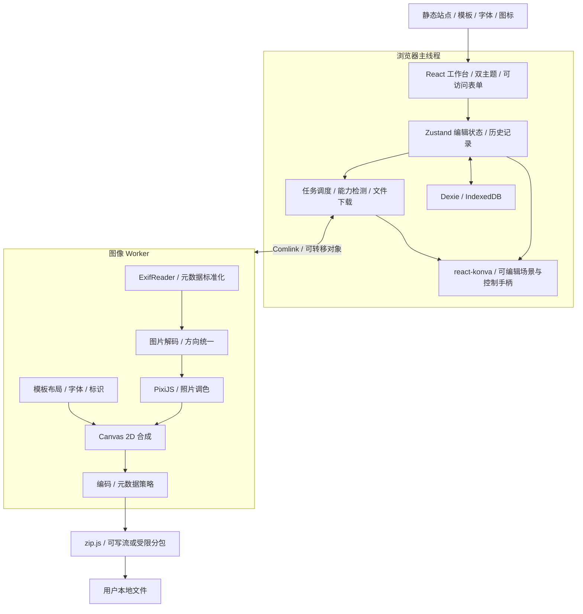

# 拾光 Frame Atelier｜技术方案 v1.1

日期：2026-11-09。依据已确认的摄影边框水印产品方案及「摄影画廊质感版 v0.3」。本版纳入 Less 与「模板是可拖动、缩放的初始布局」两项明确要求。本次交付为技术设计与选型核验，未创建业务项目、安装项目依赖或完成性能验证。

## 1. 推荐结论

采用 **浏览器本地处理优先的 React SPA**：

**React + TypeScript + Vite + Less Modules + shadcn/ui（Base UI）+ Zustand + Zod + Dexie；react-konva + Konva 负责可交互画布，PixiJS 8 负责照片 GPU 调色；独立 Canvas 2D 导出适配器负责后台高清合成，Web Worker + Comlink 负责后台执行，ExifReader 负责元数据读取，zip.js 负责批量打包。**

模板是可编辑场景的初始配置：加载后产生独立文档实例，照片、参数文字、品牌标识、个人签名和装饰元素都有稳定 ID、位置、大小、层级及约束。用户编辑可保存为新预设，不能把模板当成一张不可修改的背景图片。

首版无需账号、业务后端、服务器数据库或照片上传。浏览器打开后，原照片在本地完成处理；静态服务器提供应用代码、模板、字体和品牌素材。后续增加云端预设、账号或付费时再引入服务端。

选型原则：基础框架采用生态成熟、采用度高的方案；图像与 EXIF 等专门能力同时看维护状态、适配性和实际样本结果。npm 下载量用于判断采用度，不等同用户数、质量排名或维护保证。

## 2. 明确的技术栈

| 层次 | 推荐技术／库 | 在本产品中的职责 | 首版 |
| --- | --- | --- | --- |
| UI 框架 | React 19 | 工作台、模板库、照片队列、设置面板 | 必需 |
| 类型 | TypeScript 稳定版，strict | 约束照片、模板、预设及任务协议 | 必需 |
| 构建 | Vite 8 + 官方 React 插件 | 开发、分包、Worker 构建、静态产物 | 必需 |
| 样式 | Less + CSS Modules + CSS Variables | 业务样式用 .module.less，变量负责运行时双主题 | 必需 |
| 基础组件样式 | Tailwind CSS 4，仅用于 shadcn 基础组件 | 独立 ui.css，不混入 Less 编译链 | 必需 |
| 组件 | shadcn/ui，统一选择 Base UI 底层 | Dialog、Slider、Select、Tooltip、菜单、Toast | 必需 |
| 图标 | lucide-react | 一致的细线工具图标，按需导入 | 必需 |
| 路由 | React Router 稳定版 | 模板库与工作台，编辑工具作为子状态 | 必需 |
| 编辑状态 | Zustand 5 + Immer | 当前照片、可序列化编辑配方、撤销／重做 | 必需 |
| 校验 | Zod 4 | 表单值、预设 JSON、Worker 消息和版本迁移入口 | 必需 |
| 复杂表单 | React Hook Form + Zod resolver | 预设命名、导出规则等表单；滑块不依赖表单库逐帧渲染 | 按需 |
| 本地数据库 | Dexie 4 + IndexedDB | 草稿、个人预设、标识 Blob 与缩略图 | 必需 |
| 元数据读取 | ExifReader 4 | EXIF／XMP／ICC 读取与格式化适配 | 必需 |
| 交互画布 | react-konva + Konva | 选择、拖动、缩放控制点、层级与交互预览 | 必需 |
| 导出合成 | 浏览器原生 Canvas 2D | 按相同场景规范，在后台生成纸面、文字、标识与成片 | 必需 |
| GPU 调色 | PixiJS 8，首版固定 WebGL 路径 | 照片色彩、模糊背景、胶片颗粒 | 必需 |
| 后台执行 | Web Worker + Comlink 4 | 解码、调色、合成、编码的任务接口 | 必需 |
| ZIP | @zip.js/zip.js 2 | 逐项加入 ZIP，支持可写流与分包 | 必需 |
| 自动检查 | ESLint + Prettier + tsc | 编码规范、格式和类型检查 | 必需 |
| 测试 | Vitest + Testing Library + Playwright | 核心算法、交互、跨浏览器实际导出 | 必需 |
| 工程环境 | pnpm + Node.js 24 LTS 最新补丁 | 锁定工具链、可重复构建 | 必需 |
| 发布 | Docker 构建 + Nginx 静态托管 + CDN／HTTPS | 分发应用与素材，业务计算仍在用户本地 | 必需 |

组件仅从 shadcn/ui 官方注册表引入，再按设计定制；不直接套用默认 Dashboard。底层选 Base UI 一套，避免混用 Radix 与 Base UI 的交互 API。[官方 Vite 集成](https://ui.shadcn.com/docs/installation/vite)、[官方 Base UI 默认化说明](https://github.com/shadcn-ui/ui/blob/main/apps/v4/content/docs/changelog/2026-07-base-ui-default.mdx)。

Node 24 在本方案日期仍是受支持的 Maintenance LTS，适合成熟工具链；Node 26 已进入 Active LTS，也可在 CI 验证后升级。不要将开发机现有 Node 版本直接作为生产构建基线。[官方生命周期](https://github.com/nodejs/Release)。

### 版本与采用度快照

以下精确版本由 npm registry `latest` 于本次查询获得，下载统计区间为 **2026-11-01 至 2026-11-07**。它们是选型快照，不是已经通过联调的依赖组合。初始化时核对 engines／peerDependencies，使用锁文件固定实际通过 CI 的补丁版本。

| 包 | 查询到的稳定版本 | 周下载量 | 官方统计 |
| --- | --- | ---: | --- |
| react | 19.3.1 | 253,346,854 | [npm API](https://api.npmjs.org/downloads/point/last-week/react) |
| vite | 8.3.6 | 262,699,686 | [npm API](https://api.npmjs.org/downloads/point/last-week/vite) |
| typescript | 7.0.2 | 418,815,015 | [npm API](https://api.npmjs.org/downloads/point/last-week/typescript) |
| tailwindcss | 4.3.5 | 175,996,164 | [npm API](https://api.npmjs.org/downloads/point/last-week/tailwindcss) |
| zustand | 5.1.0 | 92,074,815 | [npm API](https://api.npmjs.org/downloads/point/last-week/zustand) |
| zod | 4.6.7 | 456,171,850 | [npm API](https://api.npmjs.org/downloads/point/last-week/zod) |
| dexie | 4.4.7 | 3,409,570 | [npm API](https://api.npmjs.org/downloads/point/last-week/dexie) |
| pixi.js | 8.22.0 | 1,826,200 | [npm API](https://api.npmjs.org/downloads/point/last-week/pixi.js) |
| exifreader | 4.54.0 | 466,329 | [npm API](https://api.npmjs.org/downloads/point/last-week/exifreader) |
| comlink | 4.4.2 | 4,142,016 | [npm API](https://api.npmjs.org/downloads/point/last-week/comlink) |
| @zip.js/zip.js | 2.24.0 | 8,602,808 | [npm API](https://api.npmjs.org/downloads/point/last-week/%40zip.js%2Fzip.js) |
| vitest | 5.1.0 | 180,265,644 | [npm API](https://api.npmjs.org/downloads/point/last-week/vitest) |
| @playwright/test | 1.65.0 | 115,726,144 | [npm API](https://api.npmjs.org/downloads/point/last-week/%40playwright%2Ftest) |

完整机器可读快照见《依赖采用度快照.json》。依赖的代码许可证以锁定版本的包声明为准；例如 ExifReader 为 MPL-2.0，Dexie 为 Apache-2.0，不能把整套依赖统称为 MIT。

## 3. 架构与模块边界



只使用一个 GPU 图形库和一个交互场景框架：PixiJS 调色、Konva 交互。Canvas 2D 是后台导出的浏览器 API。交互和导出共享业务 SceneDocument、布局与 DisplayList，通过两个适配器绘制。项目自有的代码聚焦在模板布局、照片配方、滤镜定义和导出策略，不自行实现 React、数据库、ZIP 或通用 GPU 渲染器。

### 为什么现在选择 react-konva + Konva

用户已明确：模板只是初始预设，后续需要拖动和拉伸。因此从首版就引入 **react-konva + Konva**，避免自行编写命中检测、选择控制器及变换手柄。基础模型从一开始支持元素变换；首批开放单元素选择、拖动、缩放、约束和撤销，旋转、多选组合、吸附等可在同一模型上分期交付。

Konva 提供图层、节点、事件与 Transformer，react-konva 连接 React。采用业务文档作为状态源，Konva 节点只是视图；不直接把 Stage.toJSON() 当作长期文档格式。[官方 Transformer](https://konvajs.org/docs/react/Transformer.html)、[状态序列化建议](https://konvajs.org/docs/data_and_serialization/Best_Practices.html)。

PixiJS 继续只处理照片像素效果，不维护另一套可编辑对象树；不再叠加 Fabric。完整 Konva 编辑 Stage 放在主线程，不将 react-konva 搬进 Worker。高清导出通过共享的场景数据和显示列表，由后台 Canvas 2D 适配器完成，双适配器的画面一致性是显式验收项。

### 为什么编辑器用 Vite SPA

核心任务依赖本地文件、Canvas、GPU 和 Worker，客户端执行自然匹配。首版没有必须服务端渲染的编辑页面。未来的公开模板落地页或内容站可单独引入预渲染／SSR，不要求用 Next.js 承载首版图片引擎。Vite 的 SPA 产物也便于静态托管与按功能懒加载。

## 4. 图片处理管线

### 4.1 导入与方向

1. 检查文件头、类型、文件大小及像素尺寸；首版开放 JPEG、PNG、WebP。仅看扩展名不能判断是否支持。
2. ExifReader 读取需要的 EXIF／XMP／ICC 字段，归一为领域数据；读取失败不等于照片无法编辑。
3. 方向统一优先使用 `createImageBitmap(file, { imageOrientation: 'from-image' })`；成功得到已定向位图后，不再次按照 EXIF 旋转。
4. 使用 Orientation 1–8 的固定样本验证目标浏览器；遇到不一致时由解码适配层统一纠正，业务层不散落旋转判断。
5. 原文件仅保留 File 引用；生成约 320px 缩略图及长边约 1600px 编辑代理图。只对当前照片和少量邻近照片解码。

ExifReader 官方支持读取多个图像格式及不同元数据族；这不表示首版具备这些格式的像素解码或编码能力。[ExifReader](https://github.com/mattiasw/ExifReader)、[createImageBitmap](https://developer.mozilla.org/en-US/docs/Web/API/Window/createImageBitmap)。

### 4.2 照片滤镜

选择 PixiJS 的 WebGL 渲染路径，使用固定、可测试的色彩处理顺序：

`sRGB 解码 → 必要的线性化 → 曝光／色温 → 明暗调整 → 对比／饱和 → 预设效果及强度混合 → 回到输出颜色空间`

- 内置 ColorMatrixFilter、BlurFilter、NoiseFilter 用于适用的颜色变换、虚化背景与颗粒。
- 不能用一个颜色矩阵完整替代高光／阴影调整，也不能把 brightness 当作准确的曝光 EV。实现小型自有 `PhotoToneFilter`，明确曝光、色温和明暗映射公式，作为业务滤镜代码维护。
- 8 个预设是可版本化的参数配方，不是复制 8 套引擎。`strength=0` 表示不应用预设，但用户另行设置的曝光等基础调整仍然有效；「重置全部」才恢复完整原图状态。
- 首版不宣称匹配 Lightroom 的调色算法、RAW 显影或 XMP 配方。
- 模糊强度、颗粒大小按最终输出坐标定义；预览按比例缩放。颗粒使用固定种子，避免每次渲染随机变化。

PixiJS 官方提供这些基础滤镜、自定义 shader 接口及 Worker adapter；实际 Worker 支持以锁定的稳定版本和目标浏览器验证为准，不照搬 dev 分支 API。[官方滤镜](https://pixijs.com/8.x/guides/components/filters)、[稳定版 Worker 环境说明](https://pixijs.download/v8.22.0/docs/core-concepts-5.html)。

### 4.3 排版与合成

模板定义为受版本管理的可编辑场景：画布尺寸策略、照片、底栏、品牌、参数、签名和装饰节点。每个节点包含稳定 ID、类型、父子关系、局部坐标、宽高、旋转、透明度、层级、锁定状态、布局约束及可选数据绑定。加载模板时深拷贝为独立文档，修改不会覆盖内置模板。

参数文字保存绑定，例如 `photo.exif.iso`，其值在每张照片实例化时解析。照片节点保存素材引用和 fit／crop 规则；把摄影素材、字体、事件处理器或 ImageBitmap 直接塞进文档 JSON 都不合适。

布局函数读取「已经纠正方向的图像尺寸＋输出尺寸＋场景文档」，计算实际像素坐标。编辑坐标采用文档逻辑单位，屏幕缩放只是视口变换，不改写文档。横竖图走同一函数，不按浏览器窗口定位。

提供 `fixed-canvas` 与 `adaptive-photo` 两种画布策略。固定画布中不同照片按 contain／crop 放入照片槽；自适应原图比例时，节点通过 canvas／photo／info-area 参考区、锚点及相对偏移重新布局。用户拖动后保存相对于参考区的偏移，避免批量套用到竖图时沿用横图绝对坐标。自动布局不能在每次重绘时覆盖用户手动位置。

合成顺序为：

`虚化背景或底色 → 相纸／外框 → 已调色照片 → 品牌标识 → 参数文字 → 个人 Logo／签名 → 版权文字`

照片滤镜与标识分层，保证金色／蓝色 UI 主题不会进入导出；导出也不截取 DOM 或屏幕截图。长镜头名、缺失字段和中文均由布局函数测量、换行或缩放，避免 CSS 截断规则被误当作导出规则。

首版 Logo 为 PNG／可解码透明 WebP，签名为透明图或文字；内置受控 SVG 图标可在构建或素材准备时转为位图。用户上传 SVG 不直接加入页面执行。

### 4.4 字体与颜色

- UI 使用系统无衬线字体配合自托管标题字体；**导出字体使用明确版本的自托管字体文件**，避免不同操作系统输出不同字形和宽度。
- 建立 `FontRegistry`：记录 family、weight、文件 URL、资源版本和可用字符范围。选中导出字体后在渲染上下文显式加载，确认加载成功再测量与导出。
- Worker 文字通过原生 Canvas 2D 绘制；验证 Worker 的 FontFace／字体集合能力。失败时退回主线程合成，不依赖 PixiJS 在 Worker 内加载 DOM 字体。
- 首版确定为 sRGB 工作和输出路径，检查实际 Canvas context attributes。浏览器解码、ICC 处理及 GPU 输入输出用广色域样本核对，避免重复色彩转换或给已转换像素复制原始 ICC。
- 不承诺打印级色彩管理或逐浏览器字节一致；同浏览器、同字体、同引擎版本要求稳定复现。[Canvas context attributes](https://developer.mozilla.org/en-US/docs/Web/API/CanvasRenderingContext2D/getContextAttributes)。

### 4.5 预览与导出一致性

二者共用 `resolveRecipe`、节点绑定解析、布局函数、滤镜参数、字体资源和 DisplayList。交互端将显示列表适配为 Konva 节点，导出端将其适配为 Canvas 2D draw 命令。坐标、裁剪、旋转中心、组变换、文本换行、字距与阴影语义必须统一，不宣称不同渲染适配器天然像素一致。只开放两端都已支持并通过图像回归的节点和样式。导出从原文件重新处理，绝不把 1600px 预览放大。

不能仅对当前交互 Stage 提高 pixelRatio 就声称原图高清：若照片节点仍使用代理位图，导出也不会恢复原始细节。导出使用冻结的文档快照、原图及完整资源，排除 Transformer、参考线、选框和悬停装饰。[Konva 高清导出说明](https://konvajs.org/docs/data_and_serialization/High-Quality-Export.html)。

输出长边约束包含边框。设照片原尺寸为 `W × H`，模板求得输出基准 `B_w × B_h`，最终统一缩放系数 `s` 同时作用于照片、边框、字体和标识；「不放大」要求最终照片区域尺寸不超过原始解码尺寸，不能只比较外框总尺寸。

## 5. EXIF：读取与写回分开设计

### 5.1 读取库的选择

默认选择 **ExifReader**。npm 周下载量约 46.6 万，虽低于 exifr，但本次核验显示其仓库近期仍有维护，格式覆盖和适配空间适合摄影产品。通过 `MetadataReader` 统一输出数据，不让第三方字段结构渗透到 UI。exifr 是成熟候选，不与 ExifReader 同时安装作为永久双引擎。维护依据见《技术选型依据.md》。

保存原始读取值、展示覆盖值与来源，拍摄时间默认按 EXIF 字面本地时间展示；没有时区偏移时不擅自转为 UTC 或用户当前时区。缺失值为缺失，不能补成 ISO 0、未知焦距或伪造 GPS。

### 5.2 必须明确的产品边界

当前产品中「保留原始 EXIF」的文案过宽。技术建议首版改为 **「保留拍摄参数（JPG）」**，明确是经过筛选的字段，不是保留全部 EXIF／IPTC／XMP／MakerNote／ICC。

| 输出 | 默认行为 | 用户选择保留时 |
| --- | --- | --- |
| JPG | 不复制源业务元数据 | 重新写入指定拍摄字段白名单；方向和尺寸按新图重建 |
| PNG | 不复制源 EXIF／XMP／文本备注 | 首版不提供回写开关；画面参数照常显示 |
| WebP | 不复制源 EXIF／XMP | 首版不提供回写开关；画面参数照常显示 |

白名单建议包括 Make、Model、LensModel、FNumber、ExposureTime、ISO、FocalLength、DateTimeOriginal，按用户启用的字段保存。默认排除 GPS、机身序列号、源缩略图、厂商私有块和用户备注；需要位置时必须单独设置，不能因为勾选拍摄参数而自动带入。

JPEG 写回以 **piexifjs 的 dump／insert 能力作为专项候选**，包装为可替换的 `JpegMetadataWriter`。该库维护较旧，字符串路径会增加内存，不将它作为无条件通过的主依赖；在第一阶段完成大小、方向、白名单、再读取及内存验证。它不能保证保全 XMP／ICC，也不能覆盖 PNG／WebP 写回。[官方仓库](https://github.com/hMatoba/piexifjs)。

这项能力仍在首版计划内：若验证不通过，不静默发布一个无效开关，必须在排期中解决写回实现或明确调整产品范围。若坚持「三种格式完整保留所有原始元数据」，需另做跨格式元数据写入设计与投入估算，不能由读取库直接兑现。

重新编码可能生成必要的 JFIF、密度或色彩描述字段，因此「清除元数据」在产品中定义为不带出源 EXIF／GPS／XMP 等信息，不声称输出文件完全没有任何元数据。

## 6. Worker 与性能设计

### 6.1 工作分配

主线程负责 React、Konva Stage、命中检测、选择与变换手柄、用户输入及下载入口；图像 Worker 负责解析、解码、GPU 调色、后台布局计算、Canvas 2D 合成和编码。Konva 的完整 DOM Stage 不在 Worker 中创建。

Worker 中使用 PixiJS 的 WebWorkerAdapter；照片调色不依赖 DOM Text。返回预览使用可转移 ImageBitmap，导出返回 Blob／二进制结果。Comlink 包装远程接口，并用 transfer 传递可转移对象，避免反复复制大像素数组。[Comlink](https://github.com/GoogleChromeLabs/comlink)。

能力降级：

1. Worker + OffscreenCanvas + WebGL 可用：完整后台路径。
2. Worker GPU 不可用但主线程 WebGL 可用：同一 PixiJS 滤镜移至主线程，后台仍执行可用任务；批量串行并展示进度。
3. WebGL 完全不可用：保留原图边框／签名出片；GPU 滤镜不可选，用户确认使用原图色彩后才能导出，不能静默去掉已选效果。若要求全能力无 GPU 支持，增加同公式 CPU 后备路径并单独验收。

能力探测依据真实 context 创建和小图渲染结果，而不只判断对象是否存在。[OffscreenCanvas 编码](https://developer.mozilla.org/en-US/docs/Web/API/OffscreenCanvas/convertToBlob)。

### 6.2 内存与并发

24MP 图像的单个 RGBA 缓冲区约 `24,000,000 × 4 = 96MB`，约 91.6 MiB。解码位图、GPU 输入纹理、滤镜中间纹理、Canvas 输出和编码缓冲可能同时存在。因此首版完整导出并发固定为 **1**，而非一次把 50 张原图全部解码。

- 缩略图／EXIF 读取并发不超过 2，可测量后调整。
- 代理图使用有限 LRU 缓存，原图位图仅在当前处理时持有。
- 预览请求包含递增序号，滑块更新合并到下一帧，只显示最新请求结果；过期返回的位图立即释放。
- 完整导出开始时冻结文档与配方，暂停无关预览 GPU 渲染，避免争抢显存。
- Konva Stage 仅按视口／代理图尺寸创建，控制层数；底图等不需要事件的节点关闭 listening，交互控制层不进入导出。拖动不重新解码照片或重复调色，只更新节点变换。
- 及时 `ImageBitmap.close()`、销毁纹理与 render target、释放临时 Canvas、撤销 Object URL；Blob 生命周期也要纳入预算。
- 检查 `MAX_TEXTURE_SIZE`、纹理／渲染缓冲上限和输出 Canvas 限制；相机照片加边框后可能超出限制。超限时明确要求降低输出尺寸，或进入后续分块渲染路径，不能仅按输入文件 MB 设限制。
- 初始 50 张／单张 50MB／32MP 是待压测的上限候选；能力上限取产品限制、内存预算和图形设备实际限制的交集。

### 6.3 导出任务与取消

任务状态：`queued → preparing → rendering → encoding → archiving → succeeded`，异常进入 `failed`，取消后停止启动新项目。GPU draw、浏览器编码等步骤不保证能在指令中途打断；在可取消边界检查信号，必要时终止并重建 Worker。

每项记录稳定 itemId、文件名、配方快照、输出设置和错误码。导出中编辑 UI 不改变正在生成的结果；失败重试沿用本次任务快照，用户也可明确创建新任务使用最新编辑。

## 7. 批量 ZIP 与下载

推荐 zip.js，因为它提供可写流接口和 ZIP64 等能力；采用度也足够成熟。JPEG／PNG／WebP 已经过压缩，ZIP 默认使用 store／不重复压缩，减少 CPU 及内存消耗。[zip.js](https://github.com/gildas-lormeau/zip.js/)、[ZipWriter API](https://gildas-lormeau.github.io/zip.js/api/classes/ZipWriter.html)。

- Chromium 支持时，在用户点击导出时获取文件保存句柄，将 zip.js 输出直接写入对应可写流；遵循用户手势与权限 API 的要求。
- 其他浏览器使用有大小预算的 ZIP Blob，超过预算按受控大小分为独立 ZIP 包，例如每包初始候选 100MiB，实测后调整；单个超限项可单独下载。
- **支持流式 ZIP 不代表 BlobWriter 是零内存；`Response(stream).blob()` 也会收集完整结果。** 不把这两种路径宣传为端到端流式落盘。
- 取消时停止新项目，在 writer 可安全完成的边界收尾，保留已成功项目；当前正在写入 ZIP 的项不能假设可回滚。归档写入或关闭失败时，不将损坏包当作可用成品，保留成功项索引并允许重新打包／分包。
- 重名文件加序号，清理非法文件名字符。重试按 itemId 去重，不重复加入旧输出。

因此首版不用 JSZip 作为大批量主路径；这是针对本产品输出形态的取舍，不是认为 JSZip 不主流。

## 8. 状态、模板与本地存储

### 8.1 状态归属

- Zustand：当前照片、SceneDocument、配方、面板状态、任务概要与历史游标。selection／hover／viewport 等编辑会话状态与文档分开，不进入预设。
- 独立 AssetManager：File、Blob、ImageBitmap、Canvas、GPU 资源；不放入可序列化 store 或撤销快照。
- Dexie：个人预设、标识素材、模板收藏、草稿描述和缩略图。
- localStorage：主题偏好等极小数据，不存照片或 Base64 图片。

撤销／重做使用 Zustand + Immer patches 或受限的文档快照；滑块、拖动、缩放都按一次手势合并为一条历史，不能每一个 pointermove 都持久化。交互过程可临时改变 Konva 节点以保持响应，dragend／transformend 提交一次业务命令到 store；同步处理预览面板值、取消手势和外部状态更新。批量应用也是一条可撤销的业务操作。

### 8.2 数据模型

```ts
type PhotoEdits = {
  photoId: string;
  recipeId: string;
  displayOverrides: Record<string, string>;
  localOverrides: Partial<StyleRecipe>;
};

type StyleRecipe = {
  schemaVersion: number;
  templateId: string;
  templateVersion: number;
  adjustments: Adjustments;
  filter: { id: string; version: number; strength: number; seed: number };
  scene: SceneDocument;
  frame: FrameSettings;
  metadataRules: MetadataDisplayRules;
  brand: BrandPlacement;
  signature: SignaturePlacement;
  exportDefaults: ExportSettings;
};
```

共享预设只保存「显示每张自己的 ISO」规则，不保存样片 ISO 的具体值。`resolveRecipe(shared, local)` 生成每张有效配方；手动 EXIF 展示覆盖独立存储。模板、滤镜、字体与标识需要稳定 ID 及资源版本，保证旧草稿可恢复。

### 8.3 可编辑场景的关键规则

```ts
type SceneDocument = {
  schemaVersion: number;
  sourceTemplate: { id: string; version: number };
  canvas: { width: number; height: number; mode: 'fixed-canvas' | 'adaptive-photo' };
  nodes: SceneNode[];
};
// SceneNode 使用按 type 区分的联合类型：
// photo / image / text / rect / line / group
// 共用 id、parentId、transform、opacity、visible、locked、layout。
// 文本节点使用 binding 或 literal；照片节点使用 assetId、fit、crop。
```

- **缩放与拉伸区分**：照片、Logo 默认锁定宽高比；照片裁剪由独立 crop 状态管理。允许用户明确选择非等比拉伸，但不默认把人像或 Logo 拉变形。
- **文本拉伸有语义**：侧边手柄调整文字框宽度、触发换行；角点等比调整字号与框大小。避免仅缩放位图文字导致变形和模糊。
- **变换归一**：Konva Transformer 改变的是 scaleX／scaleY。矩形和图片在手势结束时按约定归一宽高与局部变换，避免下次编辑重复缩放；组合节点保留正确的组变换，不简单展开后丢失旋转中心。[官方变换示例](https://konvajs.org/docs/react/Transformer.html)。
- **约束与操作**：最小尺寸、画布边界、锁定、层级、Delete、方向键移动、Escape 取消；对齐线、吸附和多选组合分期补充。
- **场景是单一事实来源**：保存和恢复业务节点，不能保存 Konva 节点引用、Transformer 或事件回调。素材按 ID 重新载入。
- **预设版本与实例隔离**：更新系统模板不改变已编辑草稿；用户可另存为个人模板。批量使用保留 EXIF 绑定，不能固化样片的 ISO 或机型。

### 8.4 数据表与恢复

| 表 | 内容 |
| --- | --- |
| presets | 名称、schemaVersion、recipe、创建／更新时间 |
| brandAssets | Blob／文字、类型、来源、尺寸、资源哈希 |
| drafts | 照片描述、编辑状态、关联资源 ID、修订号 |
| thumbnails | 小尺寸预览 Blob、来源指纹、缓存时间 |
| favorites | 模板 ID 与版本 |

原图默认仅会话内持有 File 引用，刷新后要求重新选择匹配文件；草稿恢复不等于照片原件永久保留。匹配先用文件名、尺寸、lastModified、像素尺寸，再在必要时用分块／完整哈希核对，不能仅用同名判断。

使用 Dexie transaction 保证草稿引用和素材写入的一致性；数据库升级提供显式版本迁移。QuotaExceededError 时停止宣称保存成功、清理可重建缓存并保留当前会话导出能力。索引库适配与 React 订阅能力有官方支持。[Dexie React 文档](https://dexie.org/docs/Tutorial/React)。

## 9. 双主题与设计实现

保持已经认可的「曜石黑＋浅香槟」及「冷白＋蓝」：

```css
:root {
  --app-bg: #f2f4f7;
  --panel-bg: #fcfdfe;
  --text-primary: #222d3d;
  --accent: #285ee1;
}
[data-theme='dark'] {
  --app-bg: #101113;
  --panel-bg: #17181b;
  --text-primary: #e8e7e3;
  --accent: #ceb992;
}
```

业务样式使用 Less + CSS Modules（`*.module.less`），全局、混入与主题分别放在 `globals.less`、`mixins.less` 和 `themes/*.less`。CSS Variables 是运行时主题的单一来源，Less 负责组织和编译，不把主题值只写成编译期 @变量。shadcn 所需 Tailwind 保留在独立 ui.css，仅扫描基础组件，与 Less 明确分离编译并约定层叠顺序。首屏渲染前读取用户偏好，防止主题闪烁；正式产品提供暗色／白色／跟随系统。偏好不进入 StyleRecipe，切换 UI 主题不触发作品重处理。[Tailwind 主题](https://tailwindcss.com/docs/theme)、[暗色模式](https://tailwindcss.com/docs/dark-mode)。

样片、模板和品牌素材由 manifest 管理；不能把产品评审用 SVG 截图直接当作可处理图片的工作台实现。字号、留白、阴影与圆角从设计 token 落地，控件保留焦点、键盘及 disabled／loading 状态。

## 10. 推荐目录与接口

首版采用一个仓库、一个前端应用，先按模块拆分，不提前上多应用 Monorepo 或微服务。

```text
src/
  app/                 路由、初始化、主题、能力检测
  components/ui/       定制后的 shadcn 基础组件
  features/
    templates/ editor/ adjustments/ branding/ export/ presets/
    editor/canvas/       Konva Stage、节点组件、Transformer、交互控制器
  domain/
    photo.ts recipe.ts template.ts scene-document.ts export-job.ts schemas.ts
  engine/
    decode/ metadata/ filters/ layout/ compose/ encode/
    scene-compiler.ts display-list.ts resource-manager.ts
    adapters/konva/     显示列表到交互节点
    adapters/canvas2d/  显示列表到高清导出绘制
  workers/
    image.worker.ts contracts.ts
  storage/
    database.ts migrations.ts repositories/
  assets/
    manifest.ts templates/ filters/ brands/ fonts/
  styles/
    tokens.less globals.less mixins.less ui.css
    themes/dark.less themes/light.less
```

图像引擎向 UI 提供窄接口，内部可替换实现：

```ts
inspect(file: File): Promise<PhotoInfo>
renderPreview(request: PreviewRequest): Promise<PreviewResult>
exportPhoto(request: FrozenExportRequest): Promise<ExportedFile>
cancelJob(jobId: string): Promise<void>
disposePhoto(photoId: string): Promise<void>
```

请求包含 jobId、photoId、revision、目标尺寸和资源版本。错误为结构化错误码，例如 `UNSUPPORTED_FORMAT`、`DECODE_FAILED`、`FONT_UNAVAILABLE`、`GPU_LIMIT_EXCEEDED`、`ENCODE_UNSUPPORTED`、`STORAGE_QUOTA`。UI 显示具体可执行建议，不直接弹出第三方异常堆栈。

## 11. 测试与性能验收

本节是开发时的验收计划，尚未执行，不以原型截图验证代替真实图片验证。

| 级别 | 重点 |
| --- | --- |
| Vitest 纯逻辑 | 6 类场景、锚点布局、变换归一、父子坐标、文字换行、节点绑定、历史、schema 升级 |
| 浏览器引擎测试 | Orientation 1–8、透明标识、中文字体、预览与导出共享公式、三种编码格式与实际 MIME |
| Playwright E2E | 导入→模板→拖动／缩放→署名→滤镜→导出；撤销；批量绑定；草稿恢复；取消重试；暗亮主题 |
| 渲染一致性 | Konva 与 Canvas 2D 对相同 DisplayList 的字体、裁剪、旋转、组变换、阴影及缩放结果进行图像回归 |
| 导出文件检查 | 真实尺寸、方向、默认 GPS 清理、JPEG 白名单回写及再读取、无源缩略图泄漏 |
| 性能测试 | 20 张 24MP JPEG 串行导出，记录耗时、失败数、内存峰值近似值、UI 响应与 GPU 错误 |
| 浏览器矩阵 | Chrome／Edge／Safari 最近两个受支持稳定大版本；Firefox 验证后决定正式支持范围 |

选择一套固定的摄影样本集：带 GPS、Orientation、广色域、损坏文件、超长镜头名、缺失 EXIF 和大尺寸透明图。引擎测试必须运行在真实浏览器；jsdom 不能验证 Canvas 编码、字体和 WebGL 行为。

初始目标：1600px 预览交互更新 P95 约 100–150ms 以内，选定基准设备上 20 张测试不崩溃、无串行增长的资源泄漏。这里的时延与批量上限均为目标，第一阶段测量后锁定；不能先承诺任意设备都以 60fps 操作 32MP 原图。

跨浏览器像素比较使用合理容差；同浏览器固定环境的图像回归更严格。验收既要看画面，也要解析实际下载文件，避免扩展名写成 WebP、内容却回退为 PNG。

## 12. 发布与运维

流程为：类型／规范检查 → 核心测试 → 浏览器导出测试 → Vite build → 版本化静态产物 → 测试环境 → 生产发布与可回退版本。

构建固定 Node／pnpm 版本并使用 `pnpm install --frozen-lockfile`。重图像依赖、滤镜引擎、ZIP 和导出字体懒加载；不把全部字体、模板预览与 WASM 一次打进入口。

Nginx／CDN 对带内容哈希的资源设置长缓存，HTML 与 manifest 使用可更新策略；配置 SPA 路由回退、正确的 Worker／字体 MIME 和 HTTPS。资源自托管或同源分发，避免远程图片 CORS 导致 Canvas 无法导出。

遥测仅接收经筛选的错误码、耗时、输出尺寸区间和引擎版本；日志不得包含照片、签名、Exif 明文或 GPS。照片处理路径保持本地，不因分析工具、客服工具或素材请求意外上传源文件。

## 13. 后续服务端扩展

当账号、跨设备预设同步或付费进入范围时，推荐继续使用主流 TypeScript 后端：**NestJS + PostgreSQL + Prisma + S3 兼容对象存储**。HTTP 请求使用浏览器 fetch，出现远程缓存和请求状态需求时再引入 TanStack Query。

服务端保存用户、预设 JSON、授权信息与用户主动同步的标识素材；源照片仍默认本地处理。高成本云端图像计算是独立功能，需要明确上传与队列，再选 Sharp 等服务端图像库，不把 Sharp 当作首版浏览器基础库。

首版不部署这些可选组件，技术方案为它们保留领域模型及资源 ID 边界，不为尚未启用的功能增加运行成本。

## 14. 实施顺序与风险闸口

| 阶段 | 交付 | 完成条件 |
| --- | --- | --- |
| A：技术验证，约 1–2 周 | 真实图解码、Konva 拖动缩放、DisplayList 双适配器、方向、Worker、1 套场景模板、滤镜、JPEG 回写、ZIP | 输出文件、内存与 Safari 路径通过样本检查；关键库锁定 |
| B：出片闭环，约 3 周 | 6 类可编辑模板、基础变换与约束、品牌与参数、PNG／文字签名、单张高清导出 | UI 与共享渲染引擎连通，输出可靠 |
| C：效率功能，约 2–3 周 | 8 预设、基础调色、历史、个人预设、批量与重试 | 批量正确性、任务快照、本地恢复通过 |
| D：质量与交付，约 1–2 周 | 双主题细节、兼容性、性能、异常、部署 | 达到测试矩阵与最终性能边界 |

在 1 名具备图像／GPU经验的前端工程师、产品设计支持和兼职测试的假设下，加入基础画布编辑及双渲染适配器后，暂估 7–10 周；阶段 A 后重新排期。若需要跨格式完整元数据、无 GPU 全功能、RAW、HEIC 或严格广色域，不能沿用此估算。

以上为新版粗估，阶段 A 后重新校准。第一阶段必须解决：① Konva／Canvas 导出一致性与变换语义；② Worker GPU；③ 24MP 峰值；④ 字体与 sRGB；⑤ JPEG 回写；⑥ ZIP 浏览器差异。任一项失败都记录能力边界并调整实现，不用静默降画质掩盖问题。

## 15. 本次交付

- 本文件：《技术方案.md》——推荐架构、具体库、处理链路、数据模型、测试与排期。
- 《技术选型依据.md》——候选库官方依据、维护情况和取舍。
- 《依赖采用度快照.json》——官方 npm registry 与下载 API 的查询结果。

建议按本方案进入阶段 A 的真实图片技术验证，随后再初始化完整功能工程。本轮尚未执行库集成或图像性能测试，所有性能数字均为待验证目标。


### 新增依赖快照（可编辑模板与 Less）

| 包 | 稳定版本快照 | 周下载量（2026-11-01—07） | 来源 |
| --- | --- | ---: | --- |
| react-konva | 19.3.2 | 2,804,780 | [npm API](https://api.npmjs.org/downloads/point/2026-11-01:2026-11-07/react-konva) |
| less | 4.9.1 | 14,558,623 | [npm API](https://api.npmjs.org/downloads/point/2026-11-01:2026-11-07/less) |
